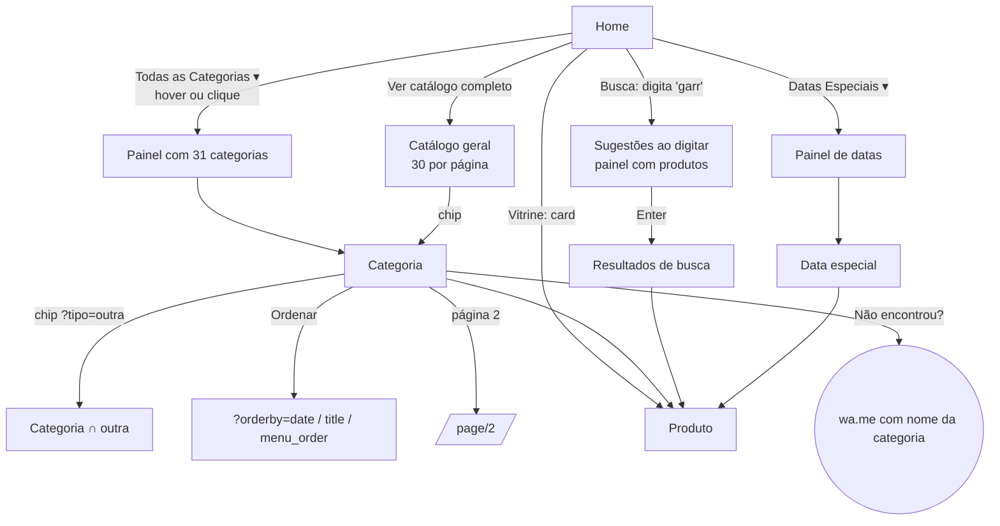
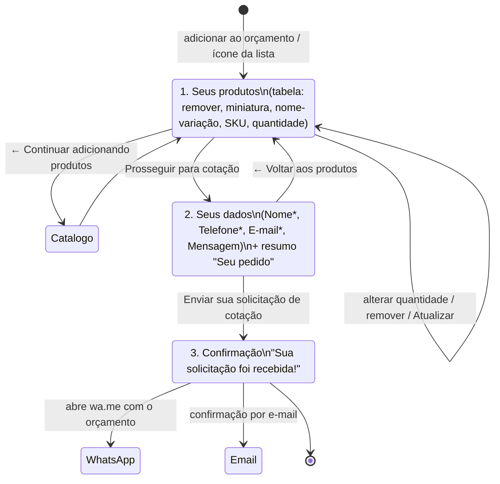
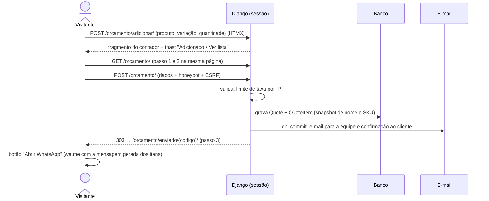
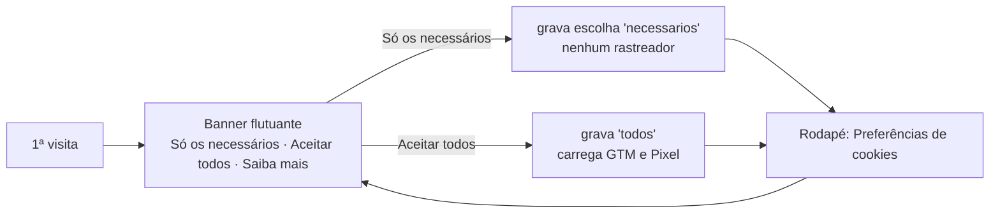

# Fluxos de navegação e de orçamento (Fase 1)

> Observados com `tools/engenharia_reversa/comportamentos.py` (resultado em `raw/comportamentos.json`). Nenhum formulário foi enviado; o item adicionado ficou só na sessão anônima da referência.

## 1. Descoberta de produto



- Chips e ordenação são **links/GET**: cada clique recarrega a página (sem XHR). A ordenação faz auto-submit do `<form method=get>`; `?tipo=` usa `rel="nofollow"`.
- Paginação em `/page/N/`; mantém `?orderby`.
- Menus e vitrines da home são montados por JS a partir da **Store API** (`/wp-json/wc/store/v1/products/categories`, `/products?category=…&orderby=popularity&per_page=10`). Isso explica o CLS de 0,13 na home.

## 2. Produto → lista de orçamento

```mermaid
sequenceDiagram
  actor V as Visitante
  participant P as Página do produto
  participant H as Header (contador)
  participant O as Orçamento passo 1
  V->>P: abre /produto/{slug}/
  Note over P: Botão "Adicionar ao orçamento" com classe disabled<br/>(cursor not-allowed). Quantidade = mínimo (25)
  V->>P: clica no botão sem escolher cor
  P-->>V: alerta "Escolha uma cor para continuar." (role=alert)
  V->>P: clica no swatch "Preto"
  P-->>V: swatch aria-pressed=true, rótulo "Cor: Preto", botão liberado, foto e SKU da variação
  V->>P: "+" (26) e "−" ×3 (para em 25); digita 1 → volta para 25
  V->>P: Adicionar ao orçamento (POST do form)
  P->>O: redirect /solicitar-orcamento-2/
  O-->>H: contador = 25 (soma das quantidades)
```

Detalhes observados:
- O contador do header mostra a **soma das quantidades** (25), não o número de itens. No projeto, o contador mostra o **número de itens** (mais útil quando a unidade varia: metros, rolos, peças) — divergência intencional.
- O `select` nativo (`attribute_cores`) fica escondido e é controlado pelos swatches; ele não tem `label` associado acessível (axe `select-name`, crítica). No projeto, o grupo de opções é um `fieldset` com `legend` e `input type=radio` estilizados.

## 3. Orçamento (3 passos)



No projeto ISF o fluxo fica:



## 4. Orçamento rápido (WhatsApp direto)

- Header ("Solicitar orçamento rápido"), hero, faixa de prazos e "Por que nós": `wa.me/<número>?text=<mensagem fixa>`.
- Categoria ("Não encontrou?"): mensagem cita a categoria.
- Mensagens observadas (só a forma, sem copiar textos): "Olá! Gostaria de solicitar um orçamento para …", "Olá! Estou vendo a categoria {X} no site e gostaria de ajuda…", "Olá! Quero reservar meu prazo…".
- No projeto: mensagens em `SiteConfiguration` com placeholders (`{categoria}`, `{produto}`); no produto, o orçamento rápido inclui nome, SKU da variação e quantidade.

## 5. Consentimento de cookies



Na referência os scripts de rastreamento estão no HTML desde o início (bloqueados neste estudo pelo próprio script). No projeto, GTM e Pixel são **injetados só depois do aceite** (princípio VIII).

## 6. Outros comportamentos

| Comportamento | Observado | Projeto |
|---|---|---|
| Header sticky | Linha do logo + barra de navegação ficam `fixed` ao rolar; faixa superior some | Igual, com `position: sticky` (sem salto de layout) |
| Rolar para cima | Botão aparece após rolar; volta ao topo | Igual, com `aria-label` e foco |
| FAQ | `<details>`; o 1º começa aberto; vários abertos ao mesmo tempo; ícone gira 45° | Igual |
| Portfólio | "Ver mais trabalhos (8) ↓" alterna classe que revela o resto; texto vira "Ver menos ↑" | Igual (`aria-expanded`) |
| Galeria | Miniaturas trocam a imagem; lupa abre tela cheia | Igual (sem zoom no hover) |
| Descrição | "Ler descrição completa ↓" expande | Igual (`aria-expanded`) |
| Foco | `outline 3px dotted` | Anel de foco "Campo" |
| Menu mobile | Painel esquerdo 86 %, overlay, trava o body, fecha no X/overlay/Esc | Igual |
| Busca | Sugestões ao digitar (painel abaixo do campo) | HTMX `hx-trigger="input changed delay:300ms"` |
