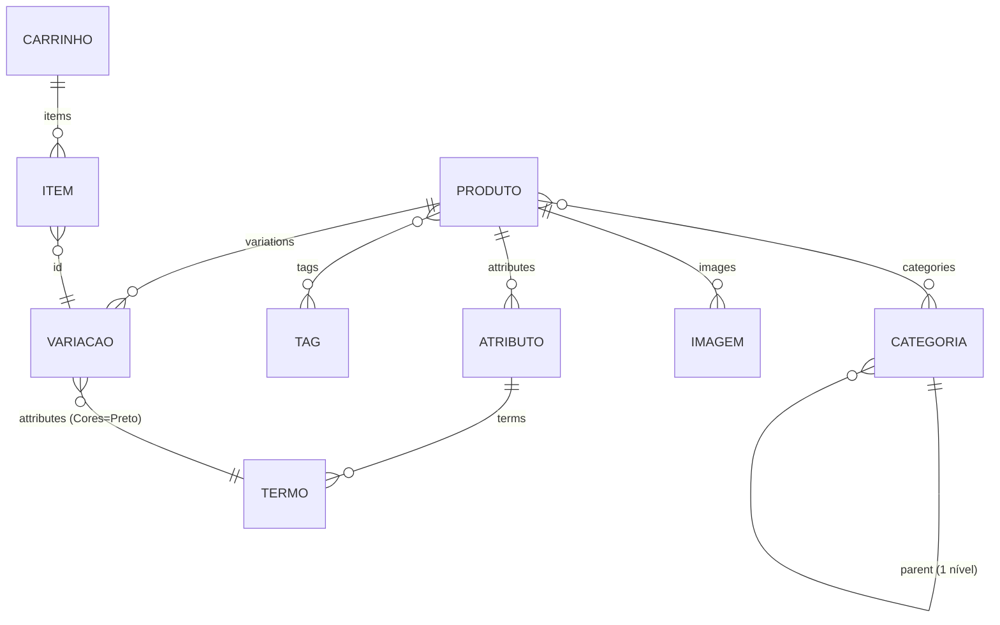

# Modelo de dados da referência (Fase 1)

> Fonte: Store API pública do WooCommerce, consultada com rate limit (`tools/engenharia_reversa/store_api.py`): `/wp-json/wc/store/v1/products/categories?per_page=100` (42 categorias), `/products?per_page=30&page=1..2` (60 produtos), `/products/{id}` de um produto variável e de uma variação. Dados brutos em `raw/api_*.json`.

## 1. Entidades observadas

### Categoria (`product_cat`)
| Campo | Exemplo | Observação |
|---|---|---|
| `id`, `name`, `slug` | `agendas` | |
| `parent` | `19` (cadernos) | Árvore de **1 nível** (2 casos) |
| `description` | texto | Usado no hero da categoria |
| `count` | `61` | Mostrado no hero, chips, tiles e menus |
| `image` | objeto | Tiles da home |
| `permalink` | `/categoria-produto/cadernos/agendas/` | Inclui o pai na URL |

12 das 42 categorias são **datas especiais** (Dia das Mães, Natal, Outubro Rosa, Novembro Azul, Dia do Cliente…) e 1 é guarda-chuva ("Brindes Corporativos", 474 produtos). Não existe campo que distinga uma data especial de uma categoria: a separação é feita à mão no menu.

### Produto
| Campo | Listagem (card) | Página do produto | Observação |
|---|---|---|---|
| `name`, `slug`, `permalink` | ✔ | ✔ | Nome longo, rico em SEO |
| `sku` | — | ✔ "Cód. TAL582" | |
| `type` | — | — | **100 % `variable`** na amostra |
| `short_description` | — (só em novidades) | ✔ abaixo do h1 | HTML |
| `description` | — | ✔ (expansível) | HTML com h2/h3, listas, links internos |
| `prices` | — | — | Preço zerado/oculto (`price_html` vazio) |
| `images[]` | 1ª imagem | galeria (≈ 8: fundo branco + "amb" de ambiente) | `alt` repetido |
| `categories[]` | — (usado para chips) | breadcrumb usa a 1ª "real"; selo = categoria principal | **M2M**, média de 6 categorias por produto |
| `tags[]` | — | só no `product_meta` | Uso de SEO ("brinde barato") |
| `attributes[]` | "N cores" + bolinhas | swatches | Único atributo: **Cores** (1 a 14 termos) |
| `variations[]` | — | ✔ | `{id, attributes: [{name: Cores, value: Preto}]}` |
| `weight`, `dimensions` | — | ficha (às vezes) e JSON-LD | |
| `average_rating`, `review_count` | — | "Avaliações" | Todos 0 |
| `is_purchasable`, `add_to_cart` | — | botão | `add_to_cart.minimum` não é exposto; o **mínimo** vem de um plugin (`data-min="25"`) |

### Variação
`id`, `sku` próprio (ex.: `TAL582-PT`), `attributes` (Cores), imagem própria, `parent`. Sem preço e sem estoque visível.

### Ficha técnica
Não é um campo estruturado: a "Especificações" do produto é um `<dl>` gerado de metadados livres (Conteúdo, Material, Medidas, Cores, Código). Varia por produto.

### Carrinho (lista de orçamento)
`/wp-json/wc/store/v1/cart` (GET a cada página) e `?wc-ajax=get_refreshed_fragments`. Item: produto, variação, quantidade. O "checkout" é um gateway falso "Solicitação de orçamento" que cria um **pedido** WooCommerce com os dados do contato.

## 2. Listagem × página de produto

| Informação | Card (listagem/vitrine) | Página do produto |
|---|---|---|
| Imagem | 1ª, quadrada 300 px | galeria completa |
| Nome | ✔ (2–3 linhas) | h1 |
| Variações | bolinhas (até 4) + "N cores" | swatches com nome |
| Selo | NOVO / MAIS PEDIDO | categoria principal |
| Descrição curta | só em Novidades | ✔ |
| SKU | — | ✔ |
| Mínimo | — | ✔ |
| Preço | — | — |

## 3. Consequências para o modelo ISF

1. **Datas especiais viram entidade própria** (`Collection`), não categoria. Evita a mistura e permite período e destaque na home.
2. **Atributo de variação deixa de ser só "Cor"**: `Category.attribute_schema` define quais chaves geram variação.
3. **Ficha técnica estruturada**: o que na referência é texto livre vira `Product.attributes` validado contra o schema (tipo e unidade).
4. **Mínimo e unidade** são campos de primeira classe (`min_quantity`, `quantity_step`, `sale_unit`), não plugin.
5. **Imagens com tipo** (`product` / `environment`), como o sufixo `_amb` da referência.
6. Tags de SEO e avaliações **não** entram agora (ver `gap-analysis.md`).
7. O "pedido de orçamento" vira `Quote` + `QuoteItem` com **snapshot** de nome e SKU (o catálogo pode ser trocado depois sem perder o histórico).
