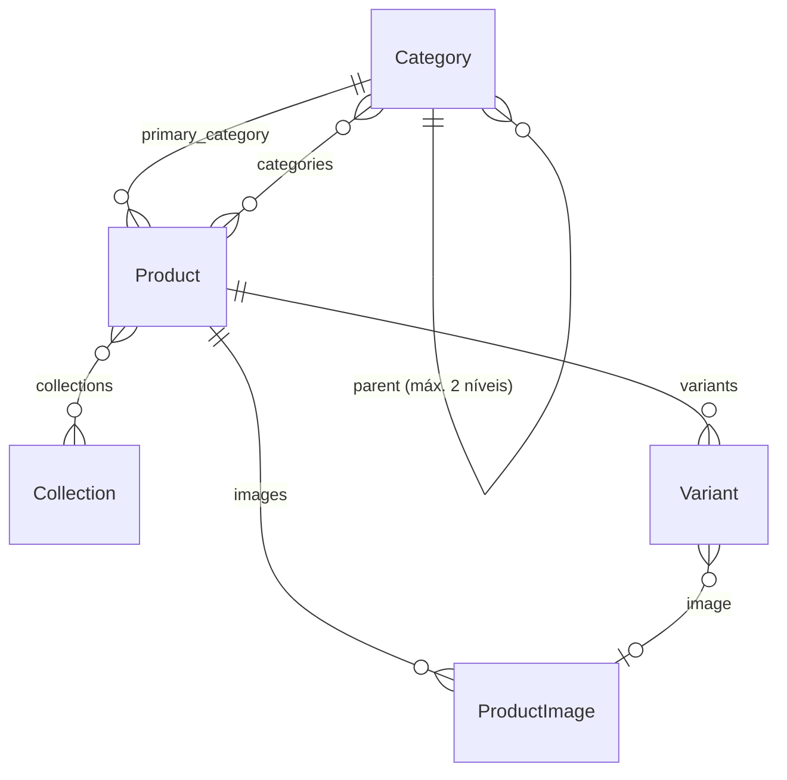

# Data model: Catálogo

## Category (`CleanSaveModel`, `TimeStampedModel`, `ActiveModel`)
| Campo | Tipo | Regra |
|---|---|---|
| name | char 120 | obrigatório |
| slug | slug 140, único | gerado do nome |
| parent | FK self, null | o pai não pode ter pai |
| description | text | hero da categoria |
| seo_text | text | bloco SEO no fim da listagem |
| image | image | tiles da home |
| icon | char 30 (escolha de ícones) | menu |
| order | int | ordenação |
| show_on_home | bool | vitrine da home |
| attribute_schema | JSON (lista) | meta-schema (R1) |
| meta_title, meta_description | char | SEO |
| is_demo | bool | |

## Collection
name, slug (único), description, seo_text, image, starts_on, ends_on (opcionais; `ends_on ≥ starts_on`), order_deadline (data), color (`TextChoices`: verde, azul, ouro, terra, escuro), featured (bool), is_main (bool, só uma), order, active, is_demo, meta_title, meta_description.
Propriedades: `period_label` ("jan–mar"), `is_current`.

## Product
name (char 200), slug (único), sku (char 60, único), short_description (char 300), description (text), primary_category (FK PROTECT), categories (M2M), collections (M2M), attributes (JSON dict), min_quantity (≥1), quantity_step (≥1), sale_unit (`SaleUnit`: piece, meter, roll, kit, box), active, featured, new_until (date), relevance (int, maior = mais relevante), is_demo, meta_title, meta_description, created_at, updated_at.
Regras: `clean()` valida `attributes` contra o schema efetivo; `min_quantity` múltiplo coerente com `quantity_step` (min ≥ step).

## Variant
product (FK CASCADE), sku (único), attributes (JSON), image (FK ProductImage, null), active, order. Regras: chaves = atributos de variação do schema; valores válidos; combinação única por produto.

## ProductImage
product (FK), image, card (WebP 400), large (WebP 900), alt (char 200), kind (`ImageKind`: product, environment), order, source (char 500, origem da importação).

## CatalogImport
file, dry_run, status (pending/done/failed), report (JSON), created_by (FK user), created_at, summary (char).
